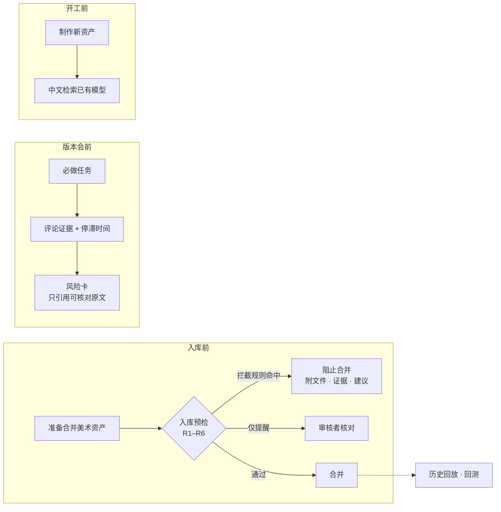

<div align="center">

# 🎨 ArtPipe · 游戏美术资产工作台

**入库预检 · 版本风险提醒 · 中文参考检索**

*Catch broken game-art assets before merge, surface schedule risk from real review comments, and find existing references in Chinese.*


</div>

> [!NOTE]
> 个人求职作品集原型（方向：腾讯 IEG · AI 产品经理），与腾讯、Wildfire Games 均无官方关联，未使用任何公司内部数据。全部演示基于开源游戏 **0 A.D.** 的真实资产与公开开发历史。

**一句话：** 美术问题里只有约两成是机器能查出来的，但它们一旦被报告，修复中位数只要 **2 天**——真正的成本是**发现得太晚**。ArtPipe 把这类客观问题挡在入库前，把审核者的时间留给需要人判断的部分。

---

## 📑 目录

- [背景与需求判断](#-背景与需求判断)
- [功能一览](#-功能一览)
- [工作流](#-工作流)
- [真实案例与评测](#-真实案例与评测)
- [快速开始](#-快速开始)
- [目录结构](#-目录结构)
- [产品决策](#-产品决策与刻意不做的事)
- [路线图](#-路线图)
- [FAQ](#-faq)
- [许可与署名](#-许可与署名)

---

## 🧩 背景与需求判断

| | |
|---|---|
| **谁** | 美术审核者（合并贡献前）、制作人（版本会前）、美术（开工前找参考） |
| **什么时刻** | 一批资产准备入库；版本冻结前排查必做任务；新资产开工 |
| **痛点** | 错等级部件、断引用、重复贴图、格式问题在集成后甚至玩家侧才暴露；任务阻塞信号埋在评论里 |
| **判断** | 客观问题用**确定性规则拦截**；风险提醒只给**可在原评论核对的证据**；美术审美不交给机器 |
| **成本** | 默认路径零模型调用；200 文件批次预检中位 **64.8 ms** |
| **安全边界** | 规则负责拦截，LLM 只做建议且必须引用 `comment_id` 与原文；资产状态和里程碑由人掌握 |

**二手调研（2026-11-17）**：0 A.D. 社区 252 个美术 Issue 分类 + 18 条公开从业者讨论（**不是用户访谈**）。

| 问题桶 | 占比 | 修复中位天数 | 含义 |
|---|---:|---:|---|
| A 工具可发现（缺文件、断引用、格式、重复） | 20% | **2** | 修得快、发现得晚 → 本工具的范围 |
| B 内容缺口 / 新资产需求 | 25% | 182 | 产能问题，不是质检问题 → 不做 |
| C 质量、表现（需要人判断） | 56% | 92 | 留给人 → 工具只辅助 |

详见 [docs/research/调研报告.md](docs/research/调研报告.md)。

## ✨ 功能一览

| 模块 | 能做什么 | 规则 / 方法 |
|---|---|---|
| 🚦 **入库预检** | 定位问题文件、证据和处理建议，可作为 CI 门禁（`--gate`） | R1 重复贴图 · R2 等级错用 · R5 引用完整性（拦截）；R3 PNG 元数据 · R4 尺寸 · R6 命名（提醒） |
| 🕰️ **历史回放** | 沿 Git 第一父链回放 3,985 次美术提交，计算问题真实存续时长 | 只取所需 XML，不全量克隆 |
| 📡 **风险雷达** | 从任务评论中提取依赖、返工、无人回应等阻塞信号，生成风险卡 | 关键词默认；LLM 可选补充，须通过引用验证 |
| 🔍 **中文参考检索** | 用中文找已有模型参考 | 中文术语扩展 + BM25（默认）；OpenCLIP 混合检索可选 |

## 🔄 工作流



## 📊 真实案例与评测

以 0 A.D. 固定提交 `14b258b10` 为准：22,028 个美术文件，回放 3,985 次美术提交，当前快照 69,123 条结构化引用全部可解析。

| 实际案例 | 工作台显示 |
|---|---|
| [#6738 重复贴图](eval/6738-before.md) | 修复前 5 组同名 PNG/DDS → 修复后 0 组 |
| [#7649 等级错用](eval/7649-before.md) | 修复前 2 处（含已报告问题和一个同类案例）；固定快照仍有 1 处同类引用，定位到第 47 行 |
| [#8414 攻城锤任务](eval/radar-8414-model.md) | 评论证据显示动画协作、贴图返工、重复工作和授权；保留依赖后来解除的记录 |
| 竹子贴图 | 2019 年命名规范化后，2022 年出现同名 PNG，重复存续约 359 天 |

<table>
<tr><th>规则人工复核（<a href="eval/acceptance.md">acceptance</a>）</th><th>风险雷达，60 条人工复核评论（<a href="eval/radar.md">radar</a>）</th></tr>
<tr><td>

| 规则 | 样本 | 人工精确率 |
|---|---:|---:|
| R1 | 30 | 100% |
| R2 | 3 | 100% |
| R5 | 30 | 100% |
| R6 | 30 | 63.3% → 修正后误报 11→0 |

</td><td>

| 方案 | 精确率 | 召回率 |
|---|---:|---:|
| **关键词** | **9/10 (90.0%)** | 9/14 (64.3%) |
| LLM | 4/7 (57.1%) | 4/14 (28.6%) |
| 并集 | 10/14 (71.4%) | 10/14 (71.4%) |

</td></tr>
</table>

**中文检索**（500 个网格、88 条中文查询，测试集）：文件名基线 Recall@10 = 0.000，中文词法 **0.569**，等权混合 0.437——因此工作台默认中文词法检索。详见 [eval/search.md](eval/search.md)。

> [!CAUTION]
> 风险雷达只有 60 条评论、14 个阳性，关键词与模型的差异**方向可信、百分比不宜外推**。复核标签由作者与一名同学各自独立标注、逐条讨论到一致，未计算一致性系数。

<details>
<summary><b>哪些结果可以离线复现？</b></summary>

| 结果 | 需要什么 | 说明 |
|---|---|---|
| #6738、#7649、PNG 元数据、UI 贴图尺寸、引用数与 3,985 次提交回放 | 一次性克隆 0 A.D. 仓库（公开、免费） | 克隆后全部离线 |
| 里程碑回测、风险卡 #8414、验收脚本里程碑步骤 | `python -m artpipe ingest --details`（公开 Gitea API，限速约 30 分钟） | 缺数据时验收脚本在里程碑步骤失败，不是规则失效 |
| 风险雷达「关键词」精确率 / 召回率 | 同上 | 不调用模型 |
| 风险雷达「模型」数字 | 硅基流动 Key 或本机缓存 | 缓存未随仓库发布，无 Key 时只能读 `eval/radar.json` |
| 中文检索评测 | 首次下载 OpenCLIP 权重 | 之后离线 |

</details>

## AssetGate · 本地模型工作台

技术美术可以上传模型，在 Blender 几何和 UV 预检后选择处理节点，对照版本结果，人工审核并导出资产包。现有 ArtPipe 服务通过 `/workbench` 提供本地工作台入口。 [本地启动与配置](docs/phase1/README.md) · [演示指南](docs/phase1/09_demo.md) · [测试报告](docs/phase1/08_test_report.md)

## 🚀 快速开始

需要 Python 3.11+、Git 2.43+。首次安装依赖与拉取 0 A.D. 数据需要网络。

```bash
git clone https://github.com/felix6328/ieg-artpipe.git && cd ieg-artpipe
python3 -m venv .venv && .venv/bin/python -m pip install -r requirements.txt

# 无需数据即可运行的单元测试
.venv/bin/python -m pytest -q

# 拉取 0 A.D. 公开仓库（blobless，不下载美术原件）
mkdir -p data
git -c protocol.version=2 clone --filter=blob:none --no-checkout --single-branch --branch main \
  https://gitea.wildfiregames.com/0ad/0ad.git data/0ad

.venv/bin/python -m artpipe ingest --issue 8414
.venv/bin/python -m artpipe replay --format json --output data/replay.json
scripts/run_app.sh            # → http://127.0.0.1:8765/
```

<details>
<summary><b>常用命令</b></summary>

```bash
# 入库预检
.venv/bin/python -m artpipe check --rev 'eafacb6e2^' --rules R1
.venv/bin/python -m artpipe check --rev HEAD --rules R1,R2,R5,R6
.venv/bin/python -m artpipe check --range '3142b7cba^..3142b7cba' --rules R2,R5
.venv/bin/python -m artpipe check --scope textures/particles/hero_aura.png --rules R3 --gate

# 风险雷达（--model 为可选 LLM 补充，需要 SILICONFLOW_API_KEY）
.venv/bin/python -m artpipe radar --issue 8414

# 中文检索
.venv/bin/python -m pip install -r requirements-search.txt
.venv/bin/python scripts/build_library.py --limit 500
.venv/bin/python scripts/search_assets.py '找攻城锤的整体模型' --category siege --visual
.venv/bin/python scripts/eval_search.py --visual
```

</details>

## 🗂️ 目录结构

```text
ieg-artpipe/
├── artpipe/                 # 核心包（python -m artpipe）
│   ├── rules.py             # R1–R6 规则
│   ├── precheck.py          # 入库预检编排、二进制按需读取
│   ├── replay.py            # Git 历史回放
│   ├── radar.py             # 风险雷达（关键词 + 可选 LLM）
│   ├── search.py            # 中文检索（术语扩展 / BM25 / OpenCLIP RRF）
│   ├── web.py               # FastAPI 工作台
│   └── templates/ static/   # 页面
├── configs/                 # precheck.yaml（规则级别）、search.yaml
├── scripts/                 # 验收、回测、评测、建库、启动脚本
├── tests/                   # pytest，离线
├── labels/                  # 人工复核标签
├── eval/                    # 所有对外数字的出处（自动生成）
├── docs/
│   ├── research/            # 二手调研 + 早期证据原型 prototypes/
│   ├── DEMO.md · COST.md · 面试讲法.md · TASK.md · 验收状态.md
└── data/                    # 本地数据缓存（gitignored，不含 0 A.D. 原件）
```

## 🧭 产品决策与刻意不做的事

| 决策 | 选择 | 理由 |
|---|---|---|
| 拦截由谁做 | 确定性规则 | 可解释、可回放，审核者信得过；LLM 不拦截 |
| 风险雷达默认 | 关键词 | 复核样本上精确率更高（9/10 vs 4/7）；模型只作补充召回 |
| 风险卡证据 | 只显示可在原评论核对的短引文 | 宁缺毋滥，避免「AI 编造阻塞原因」 |
| 检索默认 | 中文词法 | 在复核测试集上优于等权融合 |
| 不做 | 自动审美术、工时预测、内容产能（B 桶） | 机器做不好或没有可核验工时数据 |

## 🛣️ 路线图

- [x] R1–R6 预检 + CLI 门禁 + Web 工作台
- [x] 3,985 次提交历史回放与真实案例验收
- [x] 风险雷达：关键词基线 + LLM 对照 + 60 条人工复核
- [x] 中文检索评测（88 条查询）
- [x] 二手调研：252 个 Issue 分类 + 18 条从业者讨论
- [ ] 扩大风险雷达标注集并计算标注一致性
- [ ] 预检接入 Git pre-receive / CI 示例
- [ ] 在第二个开源游戏项目上验证规则可迁移性

## ❓ FAQ

<details>
<summary><b>为什么不用大模型直接审美术资产？</b></summary>

调研显示 56% 的美术问题需要人判断表现和质量。工具不该假装能「自动审美术」，而是把客观问题挡掉，把审核者的时间留给需要判断的部分。
</details>

<details>
<summary><b>模型方案精确率更低，为什么还保留？</b></summary>

合并模型候选后召回率从 64.3% 升到 71.4%。它作为可选补充存在，并且每条候选必须通过引用验证（本轮 1/8 因引用验证被拒）。
</details>

<details>
<summary><b>仓库里有 0 A.D. 的美术文件吗？</b></summary>

没有。仓库只提供抓取脚本，数据进入 gitignored 的 `data/` 目录。详见 [NOTICE](NOTICE)。
</details>

## 📄 许可与署名

- 代码：[MIT](LICENSE)，© 2026 felix6328，仅适用于本项目原创代码。
- 0 A.D. 美术素材、文件名与开发历史：© [Wildfire Games](https://www.wildfiregames.com/) 及贡献者，[CC BY-SA 3.0](https://creativecommons.org/licenses/by-sa/3.0/)。本仓库**不包含** 0 A.D. 美术原件，衍生数据（`docs/research/`、`labels/`）按 CC BY-SA 3.0 共享，详见 [NOTICE](NOTICE)。
- 可选 Poly Haven 目录：[CC0](https://polyhaven.com/license)。
