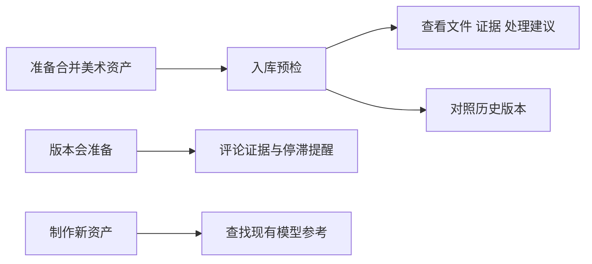

# ArtPipe｜游戏美术资产工作台

0 A.D. 的美术审核者准备合并一批贡献时，可以先定位错等级部件、断引用、重复贴图和格式问题。制作人在版本会前可以查看必做任务的评论证据，美术在开工前可以找已存在的模型参考。



| 实际案例 | 工作台显示 |
| --- | --- |
| [#6738 重复贴图](eval/6738-before.md) | 修复前 5 组同名 PNG/DDS，修复后 0 组 |
| [#7649 等级错用](eval/7649-before.md) | 修复前找到已报告的库施骑手问题和一个同类案例。固定快照仍命中阿契美尼德骑兵部件引用 |
| [#8414 攻城锤任务](eval/radar-8414-model.md) | 评论证据显示动画协作、贴图返工、重复工作和授权。时间线保留动画依赖后来解除的记录 |

以固定提交 `14b258b10` 为准，目录有 22,028 个美术文件，完整回放 3,985 次美术提交。当前快照共检查 69,123 条结构化引用，目标均能解析。规则发现的历史持续时间以实际同时满足命中条件的版本计算。比如竹子 DDS 在 2019 年命名规范化，同名 PNG 于 2022 年出现，重复持续约 359 天。 [历史回放](eval/replay.md) [当前快照报告](eval/head-precheck.md)

## 本地运行

Python 3.11+、Git 2.43+。在仓库根目录执行，首次安装依赖与数据访问需要网络。

```bash
python3.12 -m venv .venv
.venv/bin/python -m pip install -r requirements.txt
mkdir -p data
git -c protocol.version=2 clone --filter=blob:none --no-checkout --single-branch --branch main \
  https://gitea.wildfiregames.com/0ad/0ad.git data/0ad
.venv/bin/python -m artpipe ingest --issue 8414
.venv/bin/python -m artpipe replay --format json --output data/replay.json
scripts/run_app.sh
```

在浏览器访问 [ArtPipe 工作台](http://127.0.0.1:8765/)。默认打开 #6738 修复前的报告。历史回放只取所需 XML。对同一上游 Issue 列表补全评论和时间线，可运行 `.venv/bin/python -m artpipe ingest --details`。该步骤按速率限制抓取，首次用时取决于连接条件。

```bash
.venv/bin/python -m artpipe check --rev 'eafacb6e2^' --rules R1
.venv/bin/python -m artpipe check --rev HEAD --rules R1,R2,R5,R6
.venv/bin/python -m artpipe check --range '3142b7cba^..3142b7cba' --rules R2,R5
.venv/bin/python -m artpipe radar --issue 8414
.venv/bin/python -m pytest -q
```

Web 工作台的二进制预检只读本地缓存。CLI 可对选定路径按需读取文件头或获取 PNG 的完整数据，工具取不到数据时会标明待人工。比如 `--scope textures/particles/hero_aura.png --rules R3`。用 `--gate` 可在命中拦截规则或预检未完成时保留非零退出状态。默认整版检查使用四条无需二进制规则。

## 哪些结果可以离线复现

| 结果 | 需要什么 | 说明 |
| --- | --- | --- |
| 重复贴图 #6738（修复前 5 组 → 修复后 0 组）、等级错用 #7649、PNG 元数据、UI 贴图尺寸、引用数与 3,985 次提交回放 | 一次性克隆 0 A.D. 仓库（公开、免费） | 克隆后全部离线运行 |
| 里程碑回测、风险卡 #8414、`scripts/check_acceptance.py` 的里程碑步骤 | 先运行 `python -m artpipe ingest --details`（公开 Gitea API，按速率限制约 30 分钟） | 未抓取评论和时间线时，验收脚本会在里程碑步骤失败，这是缺数据，不是规则失效 |
| 风险雷达「关键词」方案对 60 条标注评论的精确率 / 召回率 | 同上，抓取评论后离线计算 | 不调用模型 |
| 风险雷达「模型」方案的数字 | 硅基流动 Key，或本机 `data/llm_cache` | 缓存未随仓库发布；没有 Key 时只能读取 `eval/radar.json` 的记录，不能复跑 |
| 中文检索评测 | 首次下载 OpenCLIP 权重 | 之后离线 |

标注说明：`labels/` 中的复核标签由作者与一名同学各自独立标注，分歧逐条讨论到一致，未计算一致性系数。风险雷达样本只有 60 条评论、14 个阳性，关键词与模型的精确率差异（9/10 对 4/7）方向可信，具体百分比不宜外推。

## 中文检索与内容检查

```bash
.venv/bin/python -m pip install -r requirements-search.txt
.venv/bin/python scripts/build_library.py --limit 500
.venv/bin/python scripts/search_assets.py --embed
.venv/bin/python scripts/search_assets.py '找攻城锤的整体模型' --category siege --visual
.venv/bin/python scripts/eval_search.py --visual
```

模型预览对汉朝、攻城器械和建筑的 Collada 原型进行 CPU 渲染。检索支持结构筛选、中文术语扩展、BM25 和 OpenCLIP 的 RRF 融合。评测包含路径匹配基线，中文查询已按交回的复核标签重跑。面数和 UV 密度检查见 [内容检查报告](eval/content-audit.md)。中文标签和失败查询见 [检索评测](eval/search.md)。工作台默认中文词法检索，因为它在复核后的测试集上优于等权融合。混合检索和以图搜图可以独立运行。 [OpenCLIP 模型来源](https://huggingface.co/laion/CLIP-ViT-B-32-xlm-roberta-base-laion5B-s13B-b90k)

`python scripts/collect_polyhaven.py` 可加一个独立的 Poly Haven 模型目录。它保留原站入口和 CC0 标签，0 A.D. 的检索及评测保持原语料。 [Poly Haven 许可](https://polyhaven.com/license)

## 数据与评测边界

- R1、R2、R4、R5 可设置确定性拦截，R3/R6 供审核者核对。R6 按复核反馈放行结构 AO 贴图目录及其子目录中的 `_AO.png` 后缀，其他大写和空格仍会报提醒。 [预检验收](eval/acceptance.md)
- 历史回放采用 Git 第一父链的实际目录变化，风险卡只显示能在来源评论中核对的短引文。
- 风险雷达默认走关键词。通过 `FB_ENV_FILE` 引用本机包含硅基流动 Key 的配置，运行 `python -m artpipe radar --issue 8414 --model`，可以比较补充抽取结果。复核样本中，关键词基线精确率更高，合并模型候选后召回率上升。安全规则、资产状态和里程碑更新由人工掌握。 [雷达评测](eval/radar.md)
- 版本表采用最终计划日期。Release 28 在指定冻结快照无符合筛选条件的美术任务，Alpha 16 报告提供了小样本回测。开源贡献项目的任务和评论可用于演示验收和协作场景，工时预测需要有可核验的工时记录。规则命中和检索复核状态见各评测文件。 [回测](eval/milestone-backtest.md) [补充样本](eval/milestone-backtest-alpha16.md)
- 美术素材来自 0 A.D.，© Wildfire Games，CC BY-SA 3.0。模型原件及缩略图在本机数据缓存中。 [Wildfire Games](https://www.wildfiregames.com/) [CC BY-SA 3.0](https://creativecommons.org/licenses/by-sa/3.0/)

[演示脚本](DEMO.md) · [面试讲法](面试讲法.md) · [费用口径](COST.md)

## 补充调研（2026-11-17）

把 0 A.D. 社区 252 个美术相关 issue 按问题类型分类，并整理了 18 条从业者公开讨论：机器能直接查出来的问题约占两成，而且一旦报上来，修复中位只要 2 天，真正的成本在于发现得太晚。见 [docs/research/调研报告.md](docs/research/调研报告.md)，分类结果见 `docs/research/0ad_art_issues_categorized.csv`。

## 许可与署名

代码采用 MIT（见 [LICENSE](LICENSE)）。0 A.D. 素材与开发历史 © Wildfire Games，CC BY-SA 3.0；本仓库不包含 0 A.D. 美术原件，只提供抓取脚本，详见 [NOTICE](NOTICE)。
