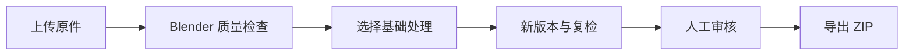

# AssetGate 1.0 · 本地模型工作台

技术美术或资产审核员可在入库前上传模型，查看三维预览和质量证据，选择基础处理，对照复检结果，再将人工通过的版本打成可交付 ZIP。



## 本机启动

该交付目录已构建前端并创建本机 Python 虚拟环境。进入仓库根目录运行以下命令，并打开 [AssetGate 本地工作台](http://127.0.0.1:8765/workbench)。

```bash
scripts/run_app.sh
```

在新的 checkout 上，先用 Python 3.11+、Node.js 20+ 和 npm 安装并构建依赖。浏览器预览需要 WebGL 2。使用 macOS 或 Linux 终端运行并安装可后台启动的 Blender。

```bash
python3.12 -m venv .venv
.venv/bin/python -m pip install -r requirements.txt
npm --prefix frontend ci
npm --prefix frontend run build
scripts/run_app.sh
```

`ASSETGATE_BLENDER` 可指定 Blender 的绝对路径。`ASSETGATE_STORAGE` 可指定独立存储目录。`ASSETGATE_CONFIG` 可指定规则及运行配置文件。`ARTPIPE_PORT` 可改服务端口。模型检查与处理走本机 Blender，网页资源从同一服务加载。

- [环境审计](00_environment_audit.md) · [项目审计](01_project_audit.md) · [实施计划](02_implementation_plan.md)
- [数据模型](03_data_model.md) · [Blender 接入](04_blender.md) · [QA 规则](05_quality_rules.md)
- [持久化流程和导出](06_workflow.md) · [工作台](07_workbench.md)
- [测试报告](08_test_report.md) · [演示指南](09_demo.md) · [已知限制](10_limits.md)

历史数据页面沿用仓库 [ArtPipe 快速开始](../../README.md#-快速开始) 中的数据准备方式。
